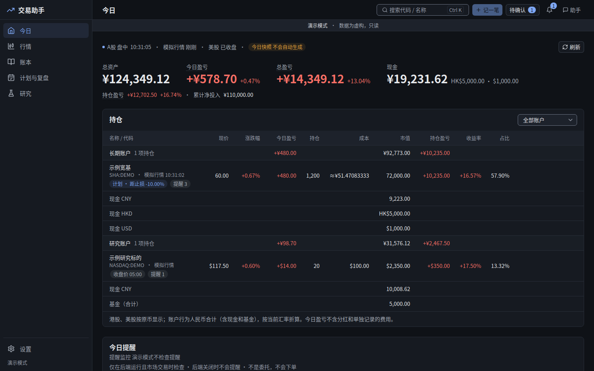
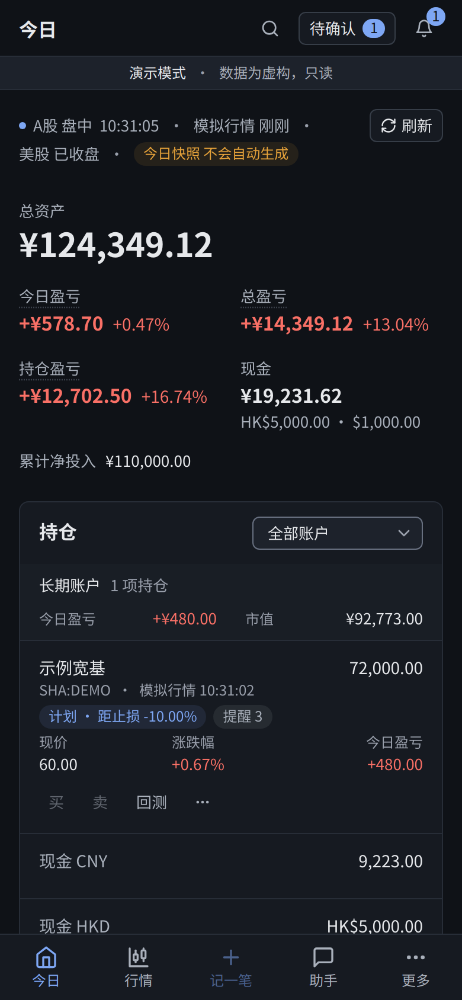
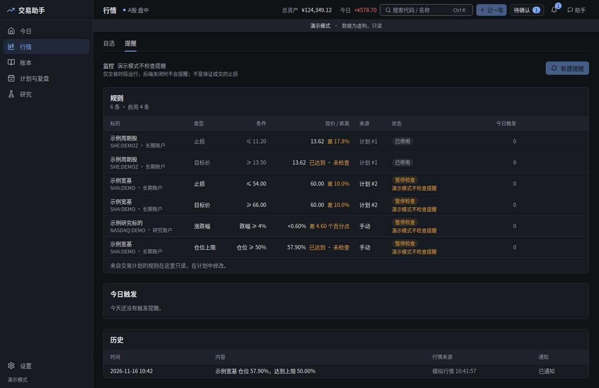
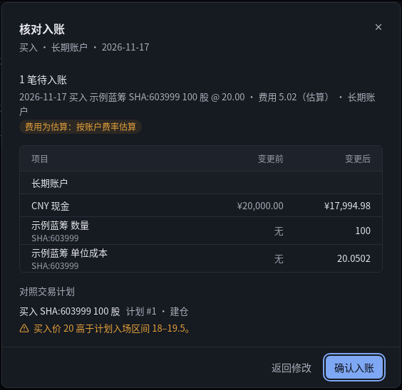
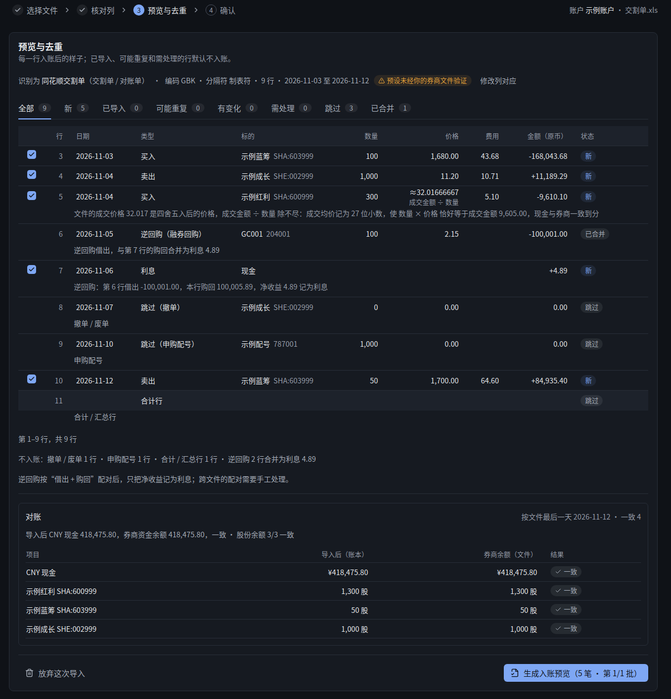
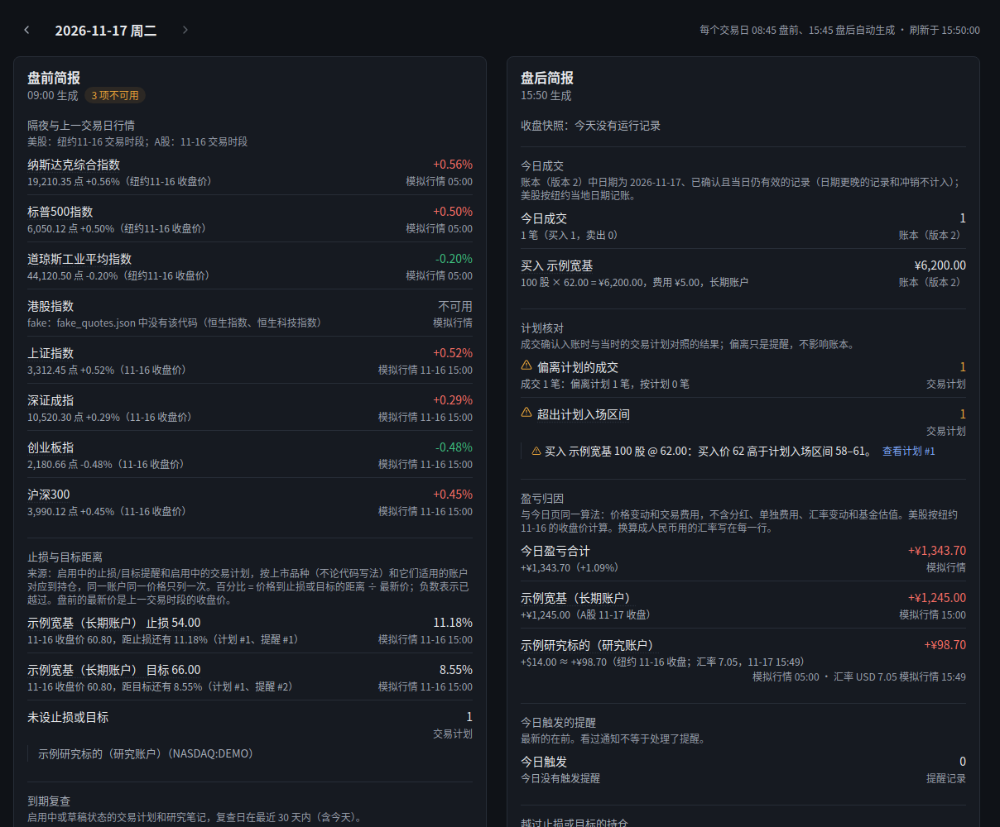
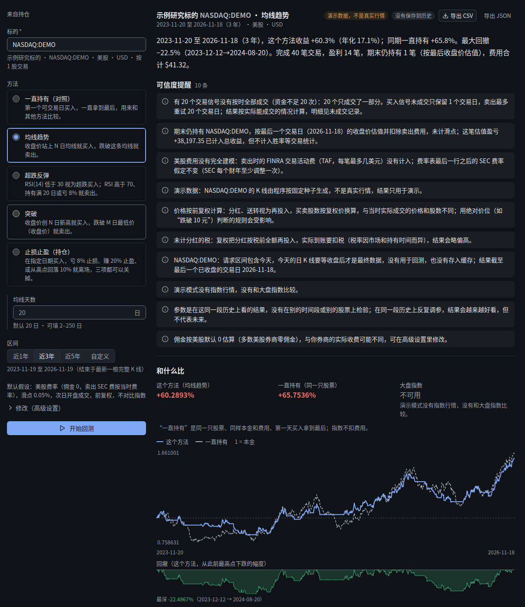
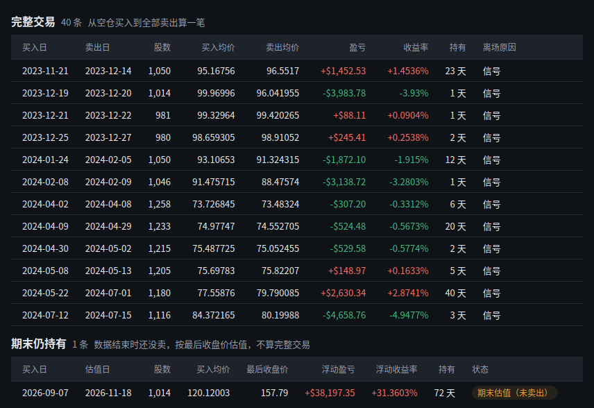

<div align="center">

# Portfolio Daily Tracker

**A self-hosted trading desk for one person: a confirmed ledger, live quotes, alerts, trade plans and daily briefs**

[](https://github.com/Stepuuu/portfolio-daily-tracker/actions/workflows/checks.yml)
[](LICENSE)
[](https://python.org)
[](https://reactjs.org)

English · [中文](README_CN.md) · [Changelog](CHANGELOG.md) · [Roadmap](docs/ROADMAP.md)

</div>

Portfolio Daily Tracker keeps your holdings in a local ledger that changes only
when you confirm a preview, and values them at live quotes from public data
sources with the source and time of every price. Around that ledger it adds
price alerts, trade plans, pre- and post-market briefs, an assistant that can
read your data but only propose changes, and a backtest that states its limits.

Version 4.0.0 (2026-11-19). The interface is in Chinese; this README gives the
Chinese label in parentheses the first time a page or button is named.

## Who it is for, and what it is not

It is for an individual investor who trades A-shares, Hong Kong or US stocks
through one or more brokers, wants one place to record trades and see the
portfolio in CNY, and is willing to run a small local service.

It is **not**:

- **a broker connection.** It never logs in to a broker and places no orders.
  Trades come from what you type, a broker export you upload, or a proposal you
  confirm.
- **investment advice.** Alerts, plans, briefs, backtests and the assistant
  report numbers and rules you set; none of them tells you what to buy.
- **a real-time feed.** Quotes come from public endpoints: Eastmoney first,
  then Tencent, then Yahoo, each asked for what the one before could not price.
  Measured once on 2026-11-17: Eastmoney mainland and Hong Kong prices arrived in
  about 2 seconds, Yahoo's about 15 minutes late, exchange rates in about 10
  seconds. Tencent, measured on 2026-11-19 from mainland hosts where Eastmoney's
  endpoints did not answer, replied in about 0.2 seconds with New York prices
  seconds old (how late its Hong Kong prices are during trading was not
  measured). Every price is labelled with its source and status, so a late price
  is never shown as live.
- **a multi-user service.** It has no login. Keep it on your own machine (see
  [SECURITY.md](SECURITY.md)).

## A tour of the six sections

### 今日 (Today) `/`



The confirmed holdings of every account at live prices: total assets, day
profit, unrealized profit (持仓盈亏), cumulative profit against contributed
capital (总盈亏, 累计净投入), cash per currency and each position's weight. Every
price shows its source and exchange time; a chip says when it is not a fresh
price: 延迟 (delayed), 收盘价 (close), 已过期 hh:mm (stale), 昨收价 (no trade yet
today), 时间未知 (no exchange time) or 不可用 (unavailable). A figure built on an
unverified price or exchange rate carries an amber 估算 (estimated) mark; a figure
that cannot be computed shows 不可用, never 0. A New York close counts as verified
only 30 minutes after the bell (16:30 New York time, 13:30 on an early-close day),
when the official closing price has been published; until then it is a 收盘价
marked 估算. Exchange holiday tables cover the
mainland in 2026 and Hong Kong and New York in 2026 and 2027 (with half days and
early closes); in other years trading days are decided by weekday alone and the
app says so (交易日历未核实（按工作日推算）). Quantities and costs are shown with
the ledger's own digits; past 8 decimal places a figure reads `≈` with 8 places
and shows its full value on hover. Below the holdings: today's alerts
(今日提醒), plans due for review (今日事项) and proposals waiting for you.



On a phone the bottom bar holds 今日 · 行情 · 记一笔 · 助手 · 更多.

### 行情 (Market) `/market`, `/alerts`

- 自选 (watchlist, up to 200 items) with live quotes and notes, and an index strip.
  Search by code or name (`Ctrl K` / `⌘K` or `/` anywhere): `000001` is 平安银行
  `SHE:000001`, never an index.
- Clicking a security opens a drawer with its daily chart, your position, its
  alerts and plans, and 设提醒 (set an alert), 加入自选 (add to watchlist) and
  去回测 (backtest it).
- 提醒 (alerts): 止损 (stop-loss), 目标价 (target price), 涨跌幅 (daily move) and
  仓位上限 (position weight) rules, checked by a monitor inside the backend during
  trading hours.



### 账本 (Ledger) `/ledger`, `/ledger/positions`, `/ledger/import`

- 记一笔 (record an entry): a dialog for buys, sells, dividends, deposits,
  withdrawals, currency exchanges, transfers, splits and reversals. Search the
  security, fill the price from the quote (按现价 / 昨收) and get the fee estimated
  from the account's fee profile (估算). 预览入账 shows the before/after of cash,
  shares and cost and the check against your trade plan; nothing changes until
  确认入账 (confirm).



- 流水 (events, with 冲销 to reverse one) and 持仓与成本 (positions and average cost).
- 导入 (import): broker 交割单, 资金对账单 and 持仓 files (CSV, TXT, XLS, XLSX; UTF-8
  or GBK). Every row gets a status; unclear rows are 需处理 (needs review) instead
  of guessed; re-importing adds nothing; balances are reconciled when the file
  has them. Presets for 同花顺, 东方财富 and 通达信 are not verified against every
  broker's real files. See [docs/IMPORT.md](docs/IMPORT.md).



### 计划与复盘 (Plans and review) `/review`, `/plans`, `/tracker`, `/notes`

- 今日简报 (briefs): 盘前简报 at 08:45 and 盘后简报 at 15:45 on A-share trading days,
  every number with its source and time.
- 计划 (trade plans): thesis, invalidation, entry range, stop, target, planned
  weight and review date. An active plan creates its alerts; 记一笔 and imports
  are checked against it and warned, never blocked.
- 组合走势 (portfolio history from the daily snapshots) and 笔记 (research notes
  with review dates).



### 研究 (Research) `/lab`, `/backtest`

- 回测 (backtest): one security, five presets, compared with holding it and with
  the market index; see [Backtesting](#backtesting).
- 工作台 (research lab): reproducible experiments on daily bars, manual or with an
  agent; see [docs/RESEARCH.md](docs/RESEARCH.md).



### 设置 (Settings) `/settings/<section>`

账户与费率 (accounts and fee profiles), 模型 (chat model and research connections),
数据与行情 (quote sources, daily-bar cache, calendar years), 自动化与通知 (alert
monitor, daily routines, notification channels), 交易偏好 (what the assistant
remembers and its pending proposals), 备份与导出 (backups and export), 关于与帮助
(version, theme, shortcuts, setup wizard).

## Quick start

Requirements: Python 3.10+, Node.js 22.12+ and Bash 4.3+ for the local launcher,
or Docker with Compose.

**Locally**

```bash
git clone https://github.com/Stepuuu/portfolio-daily-tracker.git
cd portfolio-daily-tracker
python3 -m venv .venv
source .venv/bin/activate
make setup     # Python and Node packages, configuration templates
make start     # backend on 127.0.0.1:8000, web app on 127.0.0.1:3000
```

**Docker**

```bash
docker compose up -d   # or: make docker (builds and runs in the foreground)
```

Then open http://localhost:3000/setup. On a fresh install the Today page sends
you there once. The setup wizard (设置向导) walks through 账户与期初 (the first
account and its opening balance: from scratch, from a broker file, or migrated
from v3.2 files), 费率 (fee profile), 行情与提醒 (quote, alert and routine checks)
and AI 助手 (optional chat model and key). Every step can be skipped and reopened
from 设置 › 关于与帮助. No configuration file needs editing.

Under Docker the automatic close snapshot reports 不可用 because the backend
image does not contain the engine scripts; see
[docs/ALERTS_AND_ROUTINES.md](docs/ALERTS_AND_ROUTINES.md#running-it).

On a slow or busy machine the backend can need longer to start than the 30
seconds `start.sh` waits (`Backend did not become ready within 30 seconds`), or
than its Compose health check allows (`docker compose up` reports the backend
`unhealthy`): set `BACKEND_START_TIMEOUT` (see [Configuration](#configuration)).

## Demo mode

```bash
make demo
```

This creates `.demo/portfolio` once with fictional accounts, invented tickers
(`SHA:DEMO`, `NASDAQ:DEMO` ...), scripted quotes, a watchlist, plans, alerts and
briefs, and starts the app on it with `TRACKER_DEMO_MODE=1`. A demo directory left
by an older version (v3.2.1's has no ledger) is rebuilt, but only when everything in
it is what the demo generator wrote; a directory with anything else in it (another
confirmed trade, a watchlist row, an extra file), or one that is not a generated
demo, is refused with a message and left unchanged. Open
http://localhost:3000. No API key is needed. The demo is read-only: every write
is refused, the alert monitor and the routines do not start, and only backtests
of the demo's own tickers on synthetic bars and synthetic research experiments
run (in separate storage). It never touches your own portfolio directory.

`make lab` starts only 研究 and 设置 (`TRACKER_LAB_ONLY=1`), for research without
any account.

## Configuration

Nothing is required. The setup wizard writes the model settings; everything else
is an environment variable, read from the process environment or from `.env` at
the repository root when the backend starts. Restart the backend after a change.
Under Docker, add variables to the `environment` list of the `backend` service in
`docker-compose.yml` (only `TRACKER_ALLOWED_HOSTS` and the two API keys are passed
by default).

| Variable | Default | Meaning |
|---|---|---|
| **Data and modes** | | |
| `PORTFOLIO_DIR` | `engine/portfolio` (`/app/portfolio` in Docker) | ledger, desk store, legacy holdings and snapshots |
| `TRACKER_REPORTS_DIR` | `engine/reports` | the daily Markdown reports (`portfolio-YYYYMMDD.md`) the pipeline saves and the close snapshot, the extensions' close reports and the Feishu workbench read; an absolute path, for example `PORTFOLIO_DIR/reports` so that they are backed up with the data |
| `TRACKER_CONFIG_FILE` | `config.json` in the backend's working directory (`dashboard/`) | chat model settings and keys written by the wizard |
| `TRACKER_BACKTEST_DIR` | `dashboard/data` | the backtest's bar cache and run history |
| `TRACKER_LAB_DIR` | `dashboard/data/lab` | research lab storage |
| `TRACKER_DEMO_MODE` | off | `1`: fictional data, read-only (set by `make demo`) |
| `TRACKER_LAB_ONLY` | off | `1`: research and settings only (set by `make lab`) |
| **Access** | | |
| `TRACKER_ALLOWED_HOSTS` | loopback names and `backend` | extra host names the API answers for, comma separated; see [SECURITY.md](SECURITY.md) |
| `BACKEND_HOST`, `BACKEND_PORT` | `127.0.0.1`, `8000` | backend address (`start.sh`; the port also in Compose) |
| `FRONTEND_HOST`, `FRONTEND_PORT` | `127.0.0.1`, `3000` | web app address (`start.sh`; the port also in Compose) |
| `PYTHON` | `python3` | interpreter used by `start.sh` and the engine shell scripts |
| `BACKEND_START_TIMEOUT` | `30` (`start.sh`), none (Compose) | seconds the backend may take to answer `/health` at start-up. `start.sh` gives up after it (a whole number from 1 to 3600, from the shell, e.g. `BACKEND_START_TIMEOUT=120 make start`); Compose does not count failed health checks during it (`start_period`, from `.env`) |
| **Quotes** | | |
| `TRACKER_QUOTE_SOURCE` | Eastmoney, then Tencent, then Yahoo | `eastmoney`, `tencent` or `yahoo`: only that source for quotes (Tencent has no exchange rates: with `tencent`, rates still come from Yahoo, then Eastmoney); `fake`: scripted quotes from `PORTFOLIO_DIR/fake_quotes.json` |
| `TRACKER_EASTMONEY_PROXY` | off | `1`: reach Eastmoney through the proxy in the environment |
| `TRACKER_TENCENT_PROXY` | off | `1`: reach Tencent through the proxy in the environment |
| `TRACKER_YAHOO_PROXY` | `HTTPS_PROXY` | proxy URL for Yahoo |
| `TRACKER_SYMBOL_INDEX` | on | `0`: no A-share / ETF name list for search (codes still work) |
| **Alerts and routines** | | |
| `TRACKER_ALERTS_ENABLED` | on | `0`: the alert monitor does not start |
| `TRACKER_ALERT_INTERVAL_SECONDS` | `5` | monitor cycle, 1 to 300 seconds |
| `TRACKER_CLOSE_SNAPSHOT` | on | `0`: no automatic close snapshot at 15:40 |
| `TRACKER_PREMARKET`, `TRACKER_PREMARKET_TIME` | on, `08:45` | pre-market brief switch and time |
| `TRACKER_POSTMARKET`, `TRACKER_POSTMARKET_TIME` | on, `15:45` | post-market brief switch and time |
| `TRACKER_BRIEF_COMMENTARY` | off | `1`: add the chat model's commentary to briefs |
| **Assistant** | | |
| `OPENAI_API_KEY`, `ANTHROPIC_API_KEY` | none | keys for the official endpoints; they take precedence over a key saved by the wizard, and with one set the wizard saves that official address without a typed key |
| `TRACKER_AGENT_BREADTH` | off | `1`: market breadth and sector board tools |
| `TRACKER_AGENT_CLS_FLASH` | off | `1`: the 财联社 news flash tool |
| **Backtest and research** | | |
| `TRACKER_ALLOW_CUSTOM_STRATEGIES` | off | `1`: allow uploading Python strategies (runs with the backend's privileges) |
| `TRACKER_LAB_PLUGINS`, `TRACKER_LAB_URL` | none, `http://127.0.0.1:8000` | research extensions and the CLI's backend; see [docs/RESEARCH.md](docs/RESEARCH.md) |
| **Extensions** | | |
| `TRACKER_EXTENSIONS` | none | comma-separated Python modules that add routes, background tasks, chat tools, delivery channels and a hook for each finished close report; they run with the backend's privileges; see [docs/EXTENSIONS.md](docs/EXTENSIONS.md) |
| **Legacy engine scripts** | | |
| `CONDA_ENV`, `CONDA_EXE` | none, `conda` | run the engine's child scripts in a conda environment |

## A trading day with the tool

1. **08:45** — the 盘前简报 is ready under 计划与复盘 › 今日简报 (and in the bell):
   overnight indices, how far each holding is from its stop and target, plans and
   notes due for review, announcements of your A-share holdings.
2. **During the session** — Today shows the portfolio at live prices. Alerts fire
   into the bell when a stop, target, daily move or weight limit is crossed, while
   the backend runs.
3. **After a trade** — press `N` (记一笔), enter the trade, check the preview and the
   plan check, confirm. Or, at the end of the day or week, export the 交割单 from
   your broker and import it on 账本 › 导入: already-booked rows show 已导入.
4. **15:40** — the backend makes the close snapshot, its `history.csv` row and the
   daily report (and pushes the report to Feishu if configured). With a Hong Kong
   holding it waits until Hong Kong's close is final (16:10); if the source has
   not caught up with the closing print by then, it looks again at 16:15, 16:20
   and 16:25, books the close once it is verified, and if none is by 16:28 books
   the day's last price marked 含估算.
5. **15:45** — the 盘后简报: today's trades against their plans, day profit per
   position, alerts fired, holdings beyond a stop or target, lessons the assistant
   proposed for you to confirm or reject.

## Data and backups

Everything stays on your machine:

| File | Holds |
|---|---|
| `PORTFOLIO_DIR/ledger.sqlite3` | every confirmed event (opening balance, trades, dividends, deposits and withdrawals, exchanges, splits, reversals), unconfirmed ledger proposals and research notes |
| `PORTFOLIO_DIR/desk.sqlite3` | alert rules and fired alerts, trade plans and their links to trades, the watchlist, the assistant's proposals (including rejected lessons), briefs and routine runs, import sessions and column mappings, fee profiles, notifications and the setup flags |
| `PORTFOLIO_DIR/snapshots/`, `history.csv`, `holdings/` | daily close snapshots and legacy holdings files |
| `engine/reports/` (`TRACKER_REPORTS_DIR`) | the daily Markdown reports |
| `dashboard/data/memory.json` | the assistant's memory (profile, triggers, lessons) |
| `TRACKER_CONFIG_FILE`, `.env` | model settings and keys |
| `TRACKER_BACKTEST_DIR`, `TRACKER_LAB_DIR` | backtest and research data |

**Back up**: in 设置 › 备份与导出 (Settings › backup and export) press 下载账本备份
(you get `ledger-backup.sqlite3`) and 下载桌面数据备份 (`desk-backup.sqlite3`). They
are consistent copies made while the backend runs; keep both, and download them
one after the other without booking anything in between. 导出流水（JSON） is for
reading, not for restoring. Back up the portfolio directory as well if you keep the
snapshots; the assistant's memory, model settings and keys, and backtest and
research data are in neither backup.

**Restore**:

1. Close every open page of the app and stop the backend (`make stop`; under
   Docker `docker compose stop backend`).
2. In the portfolio directory (`PORTFOLIO_DIR`, default `engine/portfolio`, which
   Docker mounts into the container), move the current `ledger.sqlite3`,
   `desk.sqlite3` and their `-wal` / `-shm` files aside.
3. Put the backups there as `ledger.sqlite3` and `desk.sqlite3`.
4. Start the backend, open the app again and compare balances, the number of
   events, alerts and plans.

More checks: [docs/LEDGER.md](docs/LEDGER.md#confirmation-and-recovery).

## Upgrading from 3.2

1. Back up as above (on 3.2, use 备份 on the ledger page; 3.2 has no desk store
   yet), or stop the backend and copy the portfolio directory.
2. Update, run `make setup`, then `make start` (or rebuild the images:
   `docker compose up -d --build`).
3. Schemas upgrade by themselves; reading never changes the ledger or the desk
   store. Open `/setup`; without a ledger, choose 迁移旧版持仓 or 导入券商文件 for
   the opening balance.
4. Once a ledger exists, the old holdings page and endpoints are read-only; old
   links redirect to the new pages.
5. Indicators now follow their standard definitions, so old backtest numbers
   differ; a backtest saved by v3.2 opens and exports but cannot be rerun.
   Duplicate alert rules are reconciled. An import preview or a B-share proposal
   still unconfirmed from before the upgrade cannot be confirmed: import the same
   file again, and discard the B-share proposal. Details:
   [upgrade notes](CHANGELOG.md#upgrade-notes).

## The assistant

The assistant (助手, the button in the header) is optional. Without a model,
the ledger, import, quotes, alerts, plans, briefs, backtests and manual research
all work. With one (DeepSeek, OpenAI, Anthropic or any OpenAI-compatible
endpoint, set in the wizard or 设置 › 模型):

- It can read the Today valuation, quotes, the watchlist, alert rules, plans,
  briefs, confirmed trades, research notes, daily price history, technical
  indicators, and stock news and announcements.
- It can only **propose**: ledger entries, alerts, plans, watchlist additions and
  lessons are previews you confirm or reject. Lessons and profile changes it
  picks up from a conversation become proposals in 设置 › 交易偏好.
- Text from news sites, providers and your own stored notes is passed to the
  model as untrusted data, and numbers it states that appear in none of the data
  it was given are footnoted. Its answers are not investment advice.
- What you send it (your question, the Today numbers, tool results, images) goes
  to the model provider you configured.

## Backtesting

研究 › 回测 tests one simple rule on one security over a period: 一直持有（对照）,
均线趋势 (moving-average trend), 超跌反弹 (RSI rebound), 突破 (breakout) or
止损止盈（持仓）(stop and target on a holding). Each result is compared with holding
the same stock under the same capital, lots, fees and execution, and with the
market index, and lists its caveats. Orders fill at the next open with 0.05%
slippage; A-share T+1, lot sizes, limit-up/limit-down days and dated taxes and
exchange fees are applied. A position still open when the data ends is listed
apart as 期末仍持有 (still held at the end), valued at the last close, and is not
counted as a completed trade. Each run keeps a manifest so it can be rerun and
compared (a run saved by v3.2 opens and exports, but cannot be rerun). Not modelled: intraday data, shorting, margin, options, screening many
stocks, Hong Kong board lots (100 is assumed), dividend tax by holding period.
A backtest describes one past path on adjusted prices with parameters chosen on
the same history; it is not a forecast.



## Feishu workbench and research lab

- [docs/FEISHU_WORKBENCH.md](docs/FEISHU_WORKBENCH.md): private-chat cards for
  daily updates, assets, reports and research through OpenClaw. With an active
  ledger the daily card records into it: its preview is the ledger's proposal and
  confirming on the card books it; without one it edits the legacy holdings files.
- [docs/RESEARCH.md](docs/RESEARCH.md) ([中文](docs/RESEARCH_CN.md)): the research lab,
  its data sources, templates, agent mode, CLI and MCP bridge.

## Development

CI (`.github/workflows/checks.yml`) runs on Python 3.10, 3.11 and 3.12 and Node 22:

```bash
# Python
python -m pip install -r dashboard/requirements.txt pytest
python scripts/check_public_artifacts.py
python -m pytest -q
(cd dashboard && python -c 'import backend.main')

# Node
node --test openclaw/feishu-workbench-bridge.test.mjs
(cd dashboard/frontend && npm ci)
node --experimental-strip-types --test "dashboard/frontend/tests/*.test.mjs"
(cd dashboard/frontend && npm run build && npm audit --audit-level=high)

# Browser smokes (headless Chromium)
python -m pip install -r dashboard/requirements.txt playwright
python -m playwright install --with-deps chromium
for smoke in tests/browser_*smoke.py; do python "$smoke" || exit 1; done
```

`make test` runs `python3 -m pytest -q`. The browser smokes save screenshots
when `TRACKER_SCREENSHOT_DIR` is set. See [CONTRIBUTING.md](CONTRIBUTING.md).

## What stays manual

- **No broker sync of any kind.** Trades come from what you type, files you
  export, or proposals you confirm.
- **Fill prices and fees.** 按现价 is a convenience; type the price on your trade
  confirmation. The fee is prefilled from the account's fee profile and marked
  估算. Booked unchanged, the mark (费用为估算) is kept only in the event's note;
  the cost and profit computed from it are not marked. If your broker charged
  another fee, reverse the event (冲销) and book it again with the real fee, or
  import the broker file.
- **Funds (场外基金).** The ledger keeps one CNY value per account, not fund
  units; update it with a 基金估值 entry when you check.
- **Corporate actions.** Dividends and 送转 are recorded by you or come in
  through an imported 交割单; nothing proposes them yet. An imported dividend
  whose gross amount less the tax withheld equals the amount posted is booked at
  the posted amount; otherwise you enter the amount received.
- **Exotic cases.** New-share payment and allotment, 配股, ETF creations and
  redemptions, fund subscriptions, convertible bonds and generic cash adjustments
  are booked by hand; 北交所 and B shares are not supported; 港股通 (Southbound
  Connect) is supported in import only, not in 记一笔.
- **Screenshots.** The assistant can read a screenshot and talk about it. The
  positions it recognises are shown in the chat only and never booked; a cost
  price is taken only when the image states one, otherwise it is empty. Enter
  trades with 记一笔 or import the file.
- **History and reasoning.** 累计净投入 history, theses, invalidation conditions
  and lessons are your own words.

## Known limitations

Known in 4.0.0 and left as they are for now:

- **记一笔.** 昨收 (previous close) has no timestamp of its own; it shows the
  current quote's time. An opening balance sent straight to the ledger API
  without `contributed_cny` books 0 contributed capital; 记一笔, the setup
  wizard, the ledger page's legacy preview and the assistant all ask for it.
  A ledger that already held one listing under two spellings before the upgrade
  (such as `HKG:700` and `HKG:00700`) keeps them as two rows, valued apart;
  entries booked after the upgrade go to the spelling the account held on the
  entry's date.
- **Setup wizard.** The 累计净投入 suggestion (cash + positions at cost + fund
  value) is not marked as an estimate once booked, and Today's cumulative profit
  is computed from it: replace it with the capital you actually paid in. The
  wizard shows the saved API address as it is (path included, query left out),
  so never put a key in the address; use the API 密钥 field.
- **Upgrade.** An import preview made before the upgrade and still unconfirmed
  (a 3.2 CSV import's included) is refused once at confirmation: import the same
  file again. A B-share proposal made before the upgrade is refused at
  confirmation; discard it.
- **Backup and restore.** Close every open page before restoring and reopen it
  afterwards. Restored with a page open, new notifications can reuse numbers
  from before the restore, and opening an old one marks new alerts as read too;
  a proposal confirmed after the backup shows 已应用 (applied) when confirmed
  again after the restore, but does not take effect: make that change in
  settings directly. The ledger and desk backups are two downloads, each a copy
  of that moment; book nothing in between and download both one after the other.
- **Import.** The 同花顺, 东方财富 and 通达信 presets are not verified against
  every broker's real exports. When the ledger has a Hong Kong listing under two
  spellings (one account holds `HKG:700` and another `HKG:00700`, or one account
  sold out `HKG:00700` and bought it back as `HKG:700`), a sale imported into an
  account holding `HKG:700` can need review with 卖出 … 股，但账本当时只持有 0 股
  (held 0 shares): the file's code resolves to the other spelling, also after you
  change it in the file or the row editor. Set the row to 跳过 (skip) and book the
  sale with 记一笔, which books it under the spelling the account held that day.
  In a file without times or 资金余额 (cash balance), a buy listed before the 入金
  (deposit) of the same day that pays for it needs review for lack of cash: tick
  允许融资 (allow margin) for that row, or move the deposit row above the buy and
  import again.
- **Backtest.** An index of another market cannot be compared over years the
  holiday table does not cover (now mainland 2026, Hong Kong and New York
  2026–2027): its missing days cannot be told from holidays, so the whole index
  comparison is unavailable. Every A-share ETF is simulated as T+1: gold, bond,
  money-market and cross-border ETFs (such as 518880, 511010, 513100, 159941)
  really trade T+0, but in a backtest shares bought that day cannot be sold that
  day, and the end valuation says shares bought on the last day could not be
  sold for T+1. Results saved by 3.2 open and export
  (marked as legacy records, missing parts 不可用) but cannot be rerun. Run
  shortly after the close (15:45) before the source has the day's bar, a backtest
  of the same symbol within the next hour does not download again and still ends
  on the previous session; run it after that hour, or press 更新到今天 (update to
  today) in 数据 (Data), to fetch again.
- **Quotes and the close snapshot.** For 30 minutes after the New York close a
  US price shows as the close but is marked 估算 (尚未最终确定, not final yet).
  With a Hong Kong holding the close snapshot shows 等待中 (waiting) at 15:40 and
  is made once Hong Kong's close is final at 16:10; when the source has not yet
  shown the closing print it looks again at 16:15, 16:20 and 16:25, books the
  close once verified, and if none is by 16:28 books the day's last price marked
  含估算. A
  mainland-only portfolio is made at 15:40. While it waits, Today's chip names
  the next look (今日快照 16:15 后记入); the latest time, 16:28, is only in the
  tooltip. A snapshot day marked 含估算 (a suspended holding, an unverified
  rate, holdings from the legacy files) is not made again when the data
  improves later. A thinly traded holding whose source does not restamp its
  price after the close shows 已过期 (stale, estimated) through the evening until
  a newer quote arrives; in the midday break so does a price stamped more than
  20 minutes before the morning's end. A source that stopped at a trade within
  those 20 minutes (11:16) shows it through the break as 收盘价 11:16, a verified
  price, and the next source is not asked until the afternoon session.
- **Assistant.** A percentage in an answer is checked only against the
  percentages in this turn's data, not against the figure it names: a 100%
  weight keeps 「涨了 100%」 ("up 100%") from being footnoted. Amounts and share
  counts are likewise checked only by their unit class. Rely on the figures the
  pages show.
- **Notifications and briefs.** Alerts and briefs go to the bell only; only the
  daily close report is pushed to Feishu when configured. A brief's 待确认 count
  includes every preview made against the current ledger revision that can still
  be confirmed, while the ledger page lists at most 30 regular proposals and 10
  manual previews, so above that the two differ.
- **Pages.** 组合走势 is still at `/tracker`; there is no lessons page: lessons are
  in 设置 › 交易偏好.

## Documentation

[Full guide (中文)](docs/FULL_GUIDE_CN.md) · [Ledger](docs/LEDGER.md) ·
[Import](docs/IMPORT.md) · [Alerts and routines](docs/ALERTS_AND_ROUTINES.md) ·
[Accounting conventions](docs/ACCOUNTING.md) · [Security](docs/SECURITY.md) ·
[Extensions](docs/EXTENSIONS.md) · [Roadmap](docs/ROADMAP.md) · [Changelog](CHANGELOG.md)

## Versions

| Version | Date | |
|---|---|---|
| [4.0.0](CHANGELOG.md#400--2026-11-19) | 2026-11-19 | Ledger-only holdings, setup wizard, broker import, 记一笔, alerts, plans, briefs, rebuilt backtest, six-section layout |
| [3.2.1](CHANGELOG.md#321--2026-09-14) | 2026-09-14 | Feishu capital flows |
| [3.2.0](CHANGELOG.md#320--2026-09-12) | 2026-09-12 | Feishu workbench, stock research workbench |
| [3.1.0](CHANGELOG.md#310--2026-09-09) | 2026-09-09 | Transaction ledger and research journal |
| [V1–V3](CHANGELOG.md#historical-milestones) | 2025–2026 | Google Sheets, then a Python engine, then the AI dashboard |

## Contributing and citation

Issues and pull requests are welcome; please never include real portfolio data.
See [CONTRIBUTING.md](CONTRIBUTING.md) and, for vulnerabilities,
[SECURITY.md](SECURITY.md).

```bibtex
@misc{portfolio-daily-tracker,
  author       = {Stepuuu},
  title        = {Portfolio Daily Tracker — Self-hosted Investment Portfolio Tracking \& AI Trading Assistant},
  year         = {2026},
  publisher    = {GitHub},
  howpublished = {\url{https://github.com/Stepuuu/portfolio-daily-tracker}},
}
```

## License

[MIT](LICENSE)
