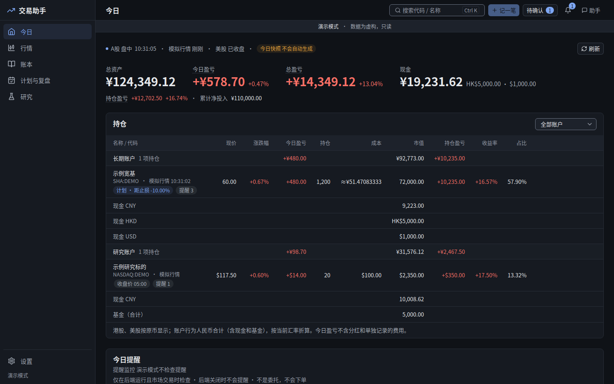
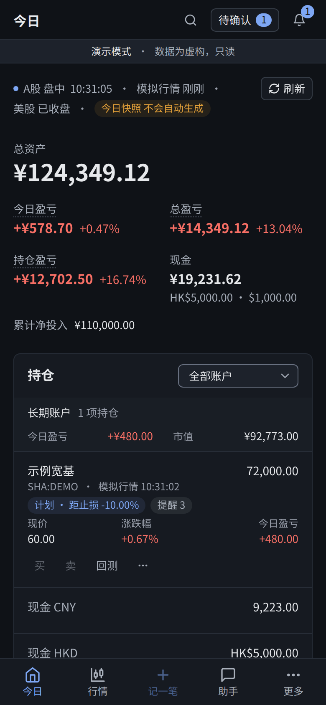
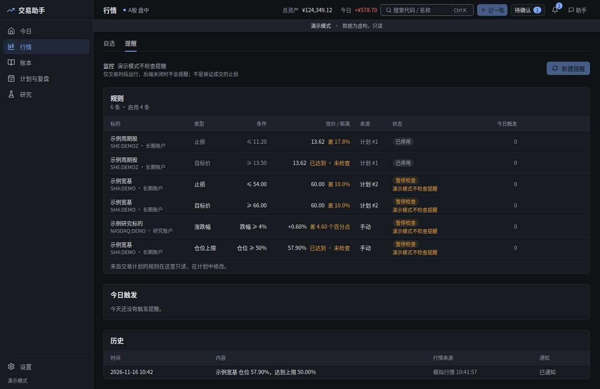
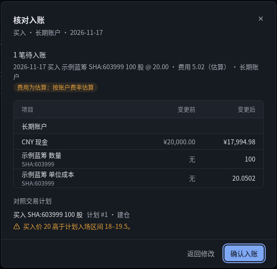
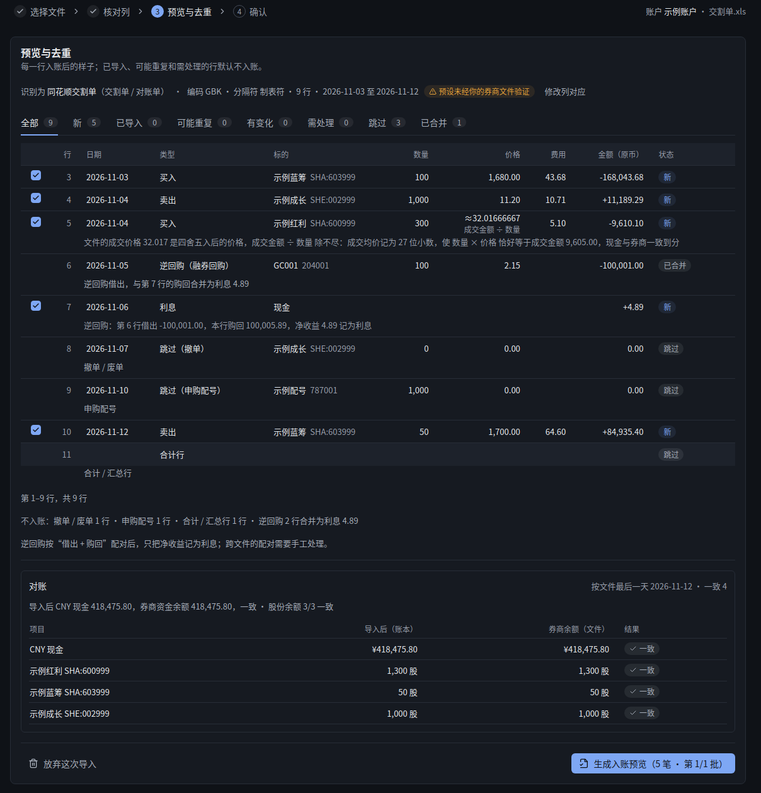
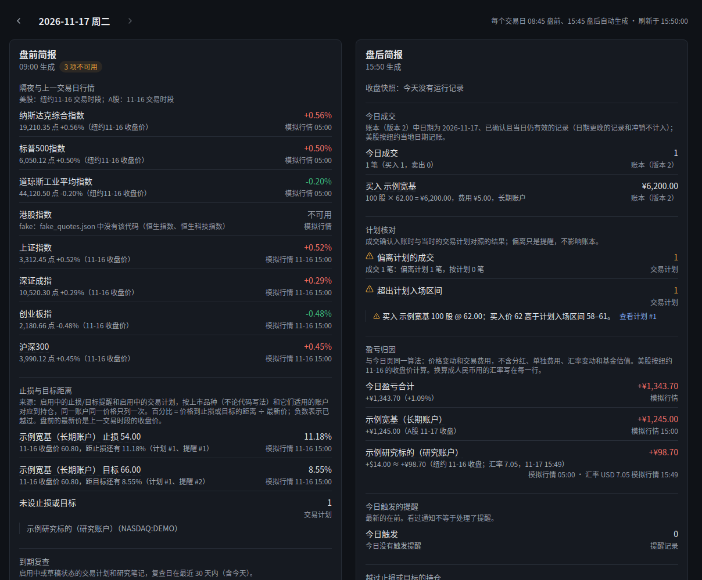
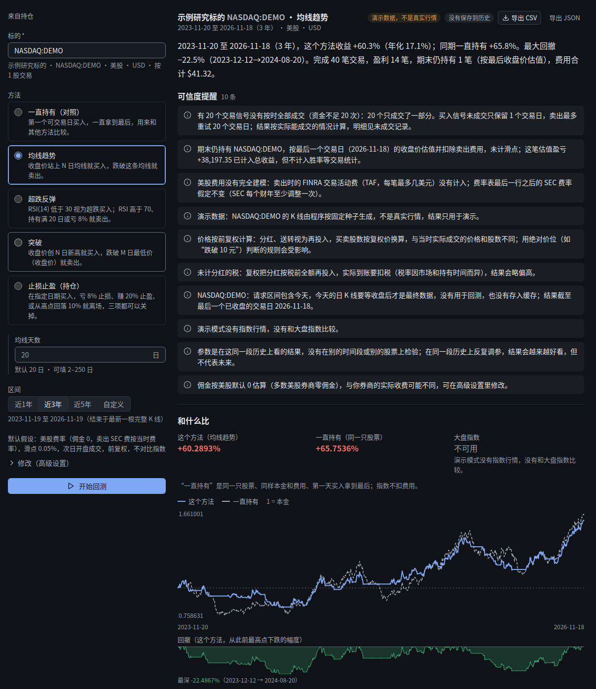
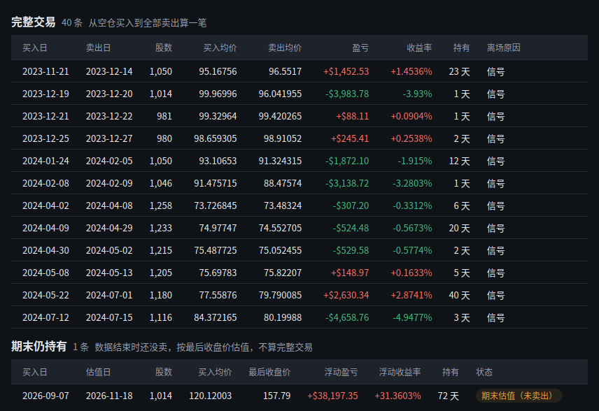

<div align="center">

# 投资组合日报追踪器 Portfolio Daily Tracker

**给个人用的自托管交易台：已确认的账本、实时行情、价格提醒、交易计划和盘前盘后简报**

[](https://github.com/Stepuuu/portfolio-daily-tracker/actions/workflows/checks.yml)
[](LICENSE)
[](https://python.org)
[](https://reactjs.org)

[English](README.md) · 中文 · [更新记录](CHANGELOG.md) · [后续计划](docs/ROADMAP.md) · [完整使用指南](docs/FULL_GUIDE_CN.md)

</div>

持仓记在本机的账本里，只有你核对预览并点「确认入账」后才会变化；页面按公开行情源的实时报价给账本估值，
每个价格都标着来源和交易所时间。围绕账本，它还提供价格提醒、交易计划、盘前盘后简报、
只能「提出方案」的助手，以及把局限写清楚的回测。

当前版本 4.0.0（2026-11-19）。

## 适合谁，不是什么

适合在一家或几家券商买卖 A 股、港股、美股的个人投资者：想在一个地方记下每笔成交、按人民币看整个组合，
并且愿意在自己电脑上跑一个小服务。

它**不是**：

- **券商接口**。不登录券商，不下单。成交只来自你手动记的、你上传的券商导出文件，或你确认的方案。
- **投资建议**。提醒、计划、简报、回测和助手只报告数字和你自己设的规则，不告诉你买什么。
- **实时行情终端**。行情来自公开接口（先东方财富，失败时用雅虎），不需要账号。2026-11-17 实测一次：
  东方财富的 A 股和港股价格约 2 秒到达，雅虎的约晚 15 分钟，汇率约 10 秒。每个价格都标明状态，
  过时的价格不会显示成实时。
- **多人服务**。没有登录功能，请只在自己的机器上使用（见 [SECURITY.md](SECURITY.md)）。

## 六个板块

### 今日 `/`



所有账户的已确认持仓按实时价格估值：总资产、今日盈亏、持仓盈亏（未实现）、总盈亏（总资产减累计净投入）、
各币种现金和每个持仓的占比。每个价格都显示来源和交易所时间，不是最新价格时有标签：

| 标签 | 含义 | 算核实价格吗 |
|---|---|---|
| （无标签） | 实时：交易所时间在 1 分钟内 | 是 |
| 延迟 | 晚 1–20 分钟 | 是 |
| 收盘价 hh:mm | 最近一个交易日的收盘价 | 是；没有节假日表的年份标为估算；美股收盘后 30 分钟内（纽约时间 16:30 前，提前收市日 13:30 前）官方收盘价尚未最终确定，也标为估算 |
| 已过期 hh:mm | 交易时段内超过 20 分钟没更新，或收盘后拿到的不是收盘价 | 否，估算 |
| 昨收价 | 今天还没成交（开盘前或停牌），按昨收估值 | 否，估算 |
| 时间未知 | 有价格但没有交易所时间 | 否，估算 |
| 不可用 | 没有可用价格 | 不计算 |

用了未经核实的价格或汇率算出的数字带琥珀色 **估算**；算不出来的数字显示 **不可用**，不会显示成 0，
包含它的合计也是不可用。行情节假日表目前收录：A 股 2026 年，港股和美股 2026、2027 年（含港股半日市和美股提前收市）；
其他年份只按工作日推算，页面会写「交易日历未核实（按工作日推算）」。
数量、成本按账本里的原始数字显示；超过 8 位小数时显示为 `≈` 加 8 位小数，鼠标悬停可看完整值。
持仓下方是 **今日提醒**、**今日事项**（到复查日的计划）和待你确认的方案。



手机底部导航：今日 · 行情 · 记一笔 · 助手 · 更多。

### 行情 `/market`、`/alerts`

- **自选**（最多 200 只）：实时行情、备注和指数条。任何页面按 `Ctrl K` / `⌘K` 或 `/` 搜索代码或名称；
  输入 `000001` 得到平安银行 `SHE:000001`，不会是上证指数。
- 点任一标的打开详情抽屉：日线图、你的持仓、相关提醒和计划，以及 **设提醒**、**加入自选**、**去回测**。
- **提醒**：止损、目标价、涨跌幅、仓位上限四种规则，由后端里的监控在交易时段检查。



### 账本 `/ledger`、`/ledger/positions`、`/ledger/import`

- **记一笔**：买入、卖出、分红、入金、出金、换汇、转账、拆股/送转、冲销等。按代码或名称选标的，
  价格可 **按现价** 或按 **昨收** 填入，费用按账户费率预填并标为 **估算**。**预览入账** 显示现金、
  股数、成本的前后变化以及与交易计划的对照；点 **确认入账** 之前什么都不会改变。



- **流水**（可 **冲销** 某一笔）和 **持仓与成本**（各账户的持仓和加权平均成本）。
- **导入**：券商的交割单、资金对账单、持仓文件（CSV、TXT、XLS、XLSX；UTF-8 或 GBK）。每一行都有状态；
  看不清的行标为 **需处理**，不会猜；重复导入不会重复入账；文件带余额列时自动对账。同花顺、东方财富、
  通达信的预设**没有用各家券商的真实文件逐一验证过**。详见 [docs/IMPORT.md](docs/IMPORT.md)。



### 计划与复盘 `/review`、`/plans`、`/tracker`、`/notes`

- **今日简报**：A 股交易日 08:45 的 **盘前简报** 和 15:45 的 **盘后简报**，每个数字都带来源和时间。
- **计划**：买入前写下理由、失效条件、入场区间、止损、目标、计划仓位和复查日。启用的计划会自动建立提醒；
  记一笔和导入会对照计划给出提示，只提醒，不拦截。
- **组合走势**（按每日收盘快照画出的历史）和 **笔记**（带复查日的研究笔记）。



### 研究 `/lab`、`/backtest`

- **回测**：一只标的、五种预设方法，与一直持有和大盘指数对比；见下文 [回测](#回测)。
- **工作台**：在日线数据上做可复查的实验，手动或交给 Agent；见 [docs/RESEARCH_CN.md](docs/RESEARCH_CN.md)。



### 设置 `/settings/<分区>`

**账户与费率**、**模型**（对话模型和研究工作台的模型连接）、**数据与行情**（行情源、日线缓存、交易日历覆盖的年份）、
**自动化与通知**（提醒监控、每日例行任务、通知渠道）、**交易偏好**（助手记住的内容和它提出待确认的修改）、
**备份与导出**、**关于与帮助**（版本、外观、快捷键、重新运行设置向导）。

## 快速开始

需要 Python 3.10+、Node.js 22.12+，本地启动脚本需要 Bash 4.3+；或者使用 Docker（含 Compose）。

**本机运行**

```bash
git clone https://github.com/Stepuuu/portfolio-daily-tracker.git
cd portfolio-daily-tracker
python3 -m venv .venv
source .venv/bin/activate
make setup     # 安装 Python 和 Node 依赖，复制配置模板
make start     # 后端 127.0.0.1:8000，网页 127.0.0.1:3000
```

**Docker**

```bash
docker compose up -d   # 或 make docker（构建并在前台运行）
```

然后打开 http://localhost:3000/setup。全新安装时，今日页会自动带你去一次。设置向导依次是
**账户与期初**（第一个账户和期初余额：从零开始、导入券商文件，或从 v3.2 的文件迁移）、**费率**、
**行情与提醒**（检查行情、提醒监控和例行任务）和 **AI 助手**（可选的对话模型和密钥）。每一步都可以跳过，
之后在 设置 › 关于与帮助 里重新打开。不需要手动编辑任何配置文件。

Docker 后端镜像不含快照引擎脚本，所以收盘自动快照显示 **不可用**；替代做法见
[docs/ALERTS_AND_ROUTINES.md](docs/ALERTS_AND_ROUTINES.md#running-it) 和
[完整使用指南](docs/FULL_GUIDE_CN.md#收盘后自动快照)。

机器较慢或负载高时，后端启动可能超过 `start.sh` 等待的 30 秒（`Backend did not become ready within 30 seconds`），
或超过 Compose 健康检查允许的时间（`docker compose up` 报后端 `unhealthy`）：设置 `BACKEND_START_TIMEOUT`（见[配置](#配置)）。

## 演示模式

```bash
make demo
```

第一次运行时在 `.demo/portfolio` 生成虚构的账户、虚构代码（`SHA:DEMO`、`NASDAQ:DEMO` 等）、模拟行情、
自选、计划、提醒和简报，然后以 `TRACKER_DEMO_MODE=1` 启动。打开 http://localhost:3000 即可，不需要 API Key。
旧版本留下的演示目录（v3.2.1 的没有账本）会重新生成，但只在目录里全是演示数据生成程序写入的内容时；
里面多了任何别的内容（多一笔确认过的交易、多一行自选、多一个文件），或者根本不是生成的演示数据，会提示后退出，不改动任何文件。
演示模式只读：所有写入都会被拒绝，提醒监控和例行任务不启动；只能对演示持仓里的代码用程序生成的行情做回测，
以及在独立存储里做合成数据的研究实验。它不会碰你自己的数据目录。

`make lab` 只启动 研究 和 设置（`TRACKER_LAB_ONLY=1`），不需要任何账户就能做研究。

## 配置

没有必填项。设置向导负责保存模型设置；其余都是环境变量，后端启动时从进程环境或仓库根目录的 `.env` 读取，
修改后重启后端。用 Docker 时，把变量加到 `docker-compose.yml` 里 `backend` 服务的 `environment`
（默认只传入 `TRACKER_ALLOWED_HOSTS` 和两个 API Key）。

| 变量 | 默认值 | 作用 |
|---|---|---|
| **数据与模式** | | |
| `PORTFOLIO_DIR` | `engine/portfolio`（Docker 中为 `/app/portfolio`） | 账本、桌面数据、旧版持仓文件和快照 |
| `TRACKER_CONFIG_FILE` | 后端工作目录（`dashboard/`）下的 `config.json` | 设置向导写入的对话模型设置和密钥 |
| `TRACKER_BACKTEST_DIR` | `dashboard/data` | 回测的日线缓存和运行历史 |
| `TRACKER_LAB_DIR` | `dashboard/data/lab` | 研究工作台的数据 |
| `TRACKER_DEMO_MODE` | 关 | `1`：虚构数据、只读（`make demo` 会设置） |
| `TRACKER_LAB_ONLY` | 关 | `1`：只有研究和设置（`make lab` 会设置） |
| **访问** | | |
| `TRACKER_ALLOWED_HOSTS` | 本机名称和 `backend` | API 额外接受的主机名，逗号分隔；见 [SECURITY.md](SECURITY.md) |
| `BACKEND_HOST`、`BACKEND_PORT` | `127.0.0.1`、`8000` | 后端地址（`start.sh`；端口也用于 Compose） |
| `FRONTEND_HOST`、`FRONTEND_PORT` | `127.0.0.1`、`3000` | 网页地址（`start.sh`；端口也用于 Compose） |
| `PYTHON` | `python3` | `start.sh` 和引擎 shell 脚本使用的解释器 |
| `BACKEND_START_TIMEOUT` | `30`（`start.sh`）、无（Compose） | 启动时后端响应 `/health` 最多可用的秒数。`start.sh` 超过它就放弃（1 到 3600 的整数，取自 shell 环境，如 `BACKEND_START_TIMEOUT=120 make start`）；Compose 在这段时间内不把失败的健康检查计数（`start_period`，取自 `.env`） |
| **行情** | | |
| `TRACKER_QUOTE_SOURCE` | 先东方财富，再雅虎 | `eastmoney` 或 `yahoo`：只用这一个源；`fake`：读取 `PORTFOLIO_DIR/fake_quotes.json` 中的模拟行情 |
| `TRACKER_EASTMONEY_PROXY` | 关 | `1`：通过环境中的代理访问东方财富 |
| `TRACKER_YAHOO_PROXY` | 使用 `HTTPS_PROXY` | 访问雅虎的代理地址 |
| `TRACKER_SYMBOL_INDEX` | 开 | `0`：搜索不加载 A 股 / ETF 名称列表（代码仍可搜索） |
| **提醒与例行任务** | | |
| `TRACKER_ALERTS_ENABLED` | 开 | `0`：不启动提醒监控 |
| `TRACKER_ALERT_INTERVAL_SECONDS` | `5` | 监控检查间隔，1 到 300 秒 |
| `TRACKER_CLOSE_SNAPSHOT` | 开 | `0`：关闭 15:40 的收盘自动快照 |
| `TRACKER_PREMARKET`、`TRACKER_PREMARKET_TIME` | 开、`08:45` | 盘前简报的开关和时间 |
| `TRACKER_POSTMARKET`、`TRACKER_POSTMARKET_TIME` | 开、`15:45` | 盘后简报的开关和时间 |
| `TRACKER_BRIEF_COMMENTARY` | 关 | `1`：简报附上对话模型的点评 |
| **助手** | | |
| `OPENAI_API_KEY`、`ANTHROPIC_API_KEY` | 无 | 官方接口的密钥；对官方接口优先于设置向导保存的密钥；设置了它，设置向导保存到对应的官方地址时不用再填密钥 |
| `TRACKER_AGENT_BREADTH` | 关 | `1`：开启市场宽度和板块工具 |
| `TRACKER_AGENT_CLS_FLASH` | 关 | `1`：开启财联社电报工具 |
| **回测与研究** | | |
| `TRACKER_ALLOW_CUSTOM_STRATEGIES` | 关 | `1`：允许上传 Python 策略（以后端进程的权限运行） |
| `TRACKER_LAB_PLUGINS`、`TRACKER_LAB_URL` | 无、`http://127.0.0.1:8000` | 研究扩展和命令行连接的后端；见 [docs/RESEARCH_CN.md](docs/RESEARCH_CN.md) |
| **扩展** | | |
| `TRACKER_EXTENSIONS` | 无 | 逗号分隔的 Python 模块，可以添加接口、后台任务、对话工具、通知渠道，以及每份收盘日报完成时的回调；以后端进程的全部权限运行；见 [docs/EXTENSIONS.md](docs/EXTENSIONS.md) |
| **旧版引擎脚本** | | |
| `CONDA_ENV`、`CONDA_EXE` | 无、`conda` | 让引擎的子脚本在指定 conda 环境中运行 |

## 一个交易日怎么用

1. **08:45**：计划与复盘 › 今日简报 里出现 **盘前简报**（铃铛里也有通知）：隔夜指数、每个持仓离止损和目标还有多远、
   到复查日的计划和笔记、A 股持仓的公告。
2. **盘中**：今日页按实时价格显示组合。后端运行期间，价格触及止损、目标、涨跌幅或仓位上限时，提醒进入铃铛。
3. **成交之后**：按 `N`（**记一笔**），填入成交，看预览和计划对照，确认。也可以在收盘后或周末从券商导出交割单，
   在 账本 › 导入 里导入：已经记过的行显示 **已导入**。
4. **15:40**：后端生成收盘快照、`history.csv` 当日记录和日报（配置了飞书时推送日报）。持有港股时等港股收盘价确定（16:10）；
   到时数据源还没拿到收盘竞价的成交价，就在 16:15、16:20、16:25 再看，看到已核实的收盘价就记入；
   到 16:28 仍没有，就按当日最后价格记入并标「含估算」。
5. **15:45**：**盘后简报**：今天的成交与计划的对照、各持仓的今日盈亏、触发的提醒、越过止损或目标的持仓，
   以及助手提出、等你确认或放弃的教训。

## 数据与备份

所有数据都在你的电脑上：

| 文件 | 内容 |
|---|---|
| `PORTFOLIO_DIR/ledger.sqlite3` | 全部已确认的流水（期初、买卖、分红、入金出金、换汇、拆股和冲销）、还没确认的账本方案、研究笔记 |
| `PORTFOLIO_DIR/desk.sqlite3` | 提醒规则和触发记录、交易计划及其与成交的关联、自选、助手提出的方案（包括你放弃过的教训）、简报和例行任务记录、导入记录和列对应、各账户费率、站内通知、设置向导的完成状态 |
| `PORTFOLIO_DIR/snapshots/`、`history.csv`、`holdings/` | 每日收盘快照和旧版持仓文件 |
| `dashboard/data/memory.json` | 助手的记忆（交易画像、情绪触发点、教训） |
| `TRACKER_CONFIG_FILE`、`.env` | 模型设置和密钥 |
| `TRACKER_BACKTEST_DIR`、`TRACKER_LAB_DIR` | 回测和研究数据 |

**备份**：在 设置 › 备份与导出 点 **下载账本备份**（得到 `ledger-backup.sqlite3`）和 **下载桌面数据备份**
（得到 `desk-backup.sqlite3`）。这是后端在运行中生成的一致副本，两个都要保存；两份是分两次下载的，备份时先不要记账，连续下载两份；**导出流水（JSON）** 只供查看，不能用来恢复。
保留收盘快照的话，另外备份整个数据目录；助手记忆、模型设置和密钥、回测和研究数据也不在这两个备份里。

**恢复**：

1. 关闭所有已打开的网页，停止后端（`make stop`，Docker 用 `docker compose stop backend`）；
2. 把数据目录（`PORTFOLIO_DIR`，默认 `engine/portfolio`；Docker 中是挂载进容器的同一个 `engine/portfolio`）里现有的
   `ledger.sqlite3`、`desk.sqlite3` 以及同名的 `-wal`、`-shm` 文件移到别处；
3. 把 `ledger-backup.sqlite3` 改名为 `ledger.sqlite3`、`desk-backup.sqlite3` 改名为 `desk.sqlite3`，放进数据目录；
4. 启动后端，再打开网页，核对账户余额、流水条数、提醒和计划。

更细的检查步骤见 [完整使用指南](docs/FULL_GUIDE_CN.md#备份与恢复)。

## 从 v3.2 升级

1. 先按上面的方法备份（3.2 在账本页点 **备份**；3.2 还没有桌面数据文件），或停止后端后直接复制数据目录。
2. 更新代码，运行 `make setup`，再 `make start`（或重新构建 Docker 镜像：`docker compose up -d --build`）。
3. 数据库结构会自动升级；读取不会改动账本和桌面数据。打开 `/setup`：还没有账本时选 **迁移旧版持仓** 或 **导入券商文件** 建立期初。
4. 账本启用后，旧的「持仓」页和接口只读；旧链接自动跳转到新页面。
5. 指标改为标准定义，旧回测结果会不同；v3.2 保存的回测记录只能打开和导出，不能重跑。重复的提醒规则会被合并。
   升级前生成、还没确认的导入预览（包括 3.2 的 CSV 导入）和 B 股方案不能再确认：导入预览请重新导入同一文件，B 股方案直接放弃。
   完整说明见 [更新记录](CHANGELOG.md#upgrade-notes)。

## 助手

助手（页头的「助手」按钮）是可选的。没有配置模型时，账本、导入、行情、提醒、计划、简报、回测和手动研究都能正常使用。
配置了模型（DeepSeek、OpenAI、Anthropic 或任何 OpenAI 兼容接口，在设置向导或 设置 › 模型 里设置）之后：

- 它能读取今日页的估值、行情、自选、提醒规则、交易计划、简报、已确认的成交、研究笔记、日线、技术指标，
  以及个股新闻和公告。
- 它只能**提出方案**：记账、提醒、计划、加自选和教训都是待你确认或放弃的预览。它从对话里归纳出的教训和
  交易画像修改，会成为 设置 › 交易偏好 里待确认的提议。
- 新闻、行情源返回的文字和你自己保存的笔记，都以「不可信数据」的形式交给模型；回答中出现、但本轮数据里没有的数字，
  会附上程序生成的脚注。它的回答不构成投资建议。
- 你发给它的内容（问题、今日数字、工具结果、图片）会发送到你配置的模型服务商。

## 回测

研究 › 回测 在一段时间内对一只标的检验一个简单规则：**一直持有（对照）**、**均线趋势**、**超跌反弹**、**突破**
或 **止损止盈（持仓）**。每个结果都和「同样本金、同样每手、同样费用和成交规则下一直持有这只股票」以及大盘指数比较，
并列出提醒事项。下一根 K 线开盘价成交，滑点 0.05%；按 A 股 T+1、每手股数、涨跌停和按日期变化的税费计算；
数据结束时还没卖出的持仓单独列在 **期末仍持有**，按最后收盘价估值，不算完整交易。
每次运行保存运行清单，可以重跑并比较差异（v3.2 保存的记录只能打开和导出，不能重跑）。没有建模：分钟数据、做空、融资、期权、多股票筛选、港股每手股数
（按 100 股假设并注明）、按持有期计算的红利税。回测只是复权价格上的一段历史，参数也是在同一段历史上看出来的，
不是预测。



## 飞书工作台与研究工作台

- [docs/FEISHU_WORKBENCH.md](docs/FEISHU_WORKBENCH.md)：通过 OpenClaw 在飞书私聊里用卡片做每日更新、查看资产、日报和研究。
  卡片写入的是旧版持仓文件，账本启用后会被拒绝。
- [docs/RESEARCH_CN.md](docs/RESEARCH_CN.md)（[English](docs/RESEARCH.md)）：研究工作台的数据、模板、Agent 模式、命令行和 MCP。

## 开发

CI（`.github/workflows/checks.yml`）在 Python 3.10、3.11、3.12 和 Node 22 上运行：

```bash
# Python
python -m pip install -r dashboard/requirements.txt pytest
python scripts/check_public_artifacts.py
python -m pytest -q
(cd dashboard && python -c 'import backend.main')

# Node
node --test openclaw/feishu-workbench-bridge.test.mjs
(cd dashboard/frontend && npm ci)
node --experimental-strip-types --test "dashboard/frontend/tests/*.test.mjs"
(cd dashboard/frontend && npm run build && npm audit --audit-level=high)

# 浏览器冒烟测试（无界面 Chromium）
python -m pip install -r dashboard/requirements.txt playwright
python -m playwright install --with-deps chromium
for smoke in tests/browser_*smoke.py; do python "$smoke" || exit 1; done
```

`make test` 运行 `python3 -m pytest -q`。设置 `TRACKER_SCREENSHOT_DIR` 时，浏览器冒烟测试会保存截图。
参见 [CONTRIBUTING.md](CONTRIBUTING.md)。

## 哪些仍需手动

- **不与券商同步**。成交只来自你手动记的、你导出的文件或你确认的方案。
- **成交价和费用**。「按现价」只是方便填写，请按成交回报填写实际价格。费用按账户费率预填并标为 **估算**；
  不改就入账时，「费用为估算」只记在这笔流水的备注里，用它算出的成本和盈亏不再标估算。券商实际收费不同的话，
  在流水里冲销后按实际费用重记，或导入券商文件。
- **场外基金**。账本按账户记一个人民币合计估值，不记份额；查看后用「基金估值」更新。
- **公司行动**。分红和送转由你记录，或随导入的交割单进来；目前不会自动提出。导入的分红在文件写明税前金额、
  扣除的税费和到账金额且三者对得上时按到账金额记，否则请填写实际到账的金额。
- **特殊情况**。新股中签缴款与入账、配股、ETF 申赎、场外基金申购、可转债和通用的资金调整需要手动处理；
  北交所和 B 股不支持；港股通只在导入里支持，记一笔不支持。
- **截图**。助手可以看截图并讨论，识别出的持仓只在对话里展示，不会入账；成本价只取图片里明确写出的，没写就为空。
  入账请用记一笔或导入文件。
- **历史与理由**。累计净投入的历史、投资理由、失效条件和教训，都是你自己写的。

## 已知限制

4.0.0 发布时已知、暂不修改的地方：

- **记一笔**：「昨收」没有自己的时间戳，显示的是当前报价的时间。不经页面、直接调用入账接口建立期初时可以不带
  累计净投入，这时按 0 记账；记一笔、设置向导、流水页的旧持仓预览和助手都会先要求填写。
  升级前已用两种写法记入同一标的的旧账本（如 `HKG:700` 与 `HKG:00700`）保持原样，仍显示为两行、分别计算；
  升级后新记的交易记入账户在成交日期持有的那种写法。
- **设置向导**：累计净投入的建议值按「现金＋持仓成本＋基金估值」估算，入账后不再标为估算，今日页的总盈亏按它计算，
  请改成实际累计转入的本金。向导会原样显示已保存的 API 地址（包括路径，不含查询参数），请不要把密钥写进地址，
  填在「API 密钥」一栏。
- **升级**：升级前生成、还没确认的导入预览（包括 3.2 CSV 导入的预览）确认时会被拒绝一次，请重新导入同一文件；
  升级前生成的 B 股方案确认时会被拒绝，可以直接放弃。
- **备份与恢复**：恢复前请关闭所有已打开的页面，恢复后再打开。页面开着时恢复，新通知可能沿用恢复前的编号，
  点开旧通知会把新的提醒一起标为已读；备份之后已经确认过的提议，恢复后再次确认会显示「已应用」但不会再生效，
  这类改动请到设置里直接修改。账本和桌面数据两份备份分两次下载，各自是下载那一刻的内容；备份时先不要记账，连续下载两份。
- **导入**：同花顺、东方财富、通达信的预设没有用各家券商的真实文件逐一验证过。同一只港股在账本里有两种写法时
  （两个账户分别是 `HKG:700` 和 `HKG:00700`，或同一账户先以 `HKG:00700` 清仓、再以 `HKG:700` 买回），
  导入持有 `HKG:700` 的账户的卖出，预览可能提示「卖出 … 股，但账本当时只持有 0 股」：文件里的代码会被读成另一种写法，
  改文件里的代码或在行编辑里改代码也一样。请把这一行设为跳过，用记一笔记这笔卖出（记一笔会记入该账户当时持有的写法）。
  没有成交时间、也没有资金余额的文件里，同一天的买入排在为它付款的入金之前时，这笔买入会提示现金不足、需要处理：
  在处理这一行时勾选「允许融资」，或在文件里把入金行移到买入之前再导入。
- **回测**：对比另一个市场的指数时，回测区间落在休市表没有收录的年份（目前 A 股 2026 年，港股和美股 2026–2027 年），
  指数缺少的交易日无法确认是休市，整段指数对比显示为不可用。A 股 ETF 一律按 T+1 模拟：黄金、债券、货币和跨境 ETF
  （如 518880、511010、513100、159941）实际可以当天买卖，回测里当天买入的份额不能当天卖出，期末估值也会把当天买入的份额说成因 T+1 卖不出。
  3.2 保存的回测结果只能打开和导出（标为旧版本记录，缺少的部分显示不可用），不能重跑。
  收盘后不久（如 15:45）跑过一次、数据源还没有当天日线时，一小时内再跑同一标的不会重新下载，结果仍截至前一个交易日；
  一小时后再跑，或在 **数据** 里点 **更新到今天**，才会再去取。
- **行情与快照**：纽约收盘后 30 分钟内，美股价格显示为收盘价但标估算（尚未最终确定），满 30 分钟后读到的才算核实的收盘价。
  持有港股时，收盘快照在 15:40 显示「等待中」，港股收盘价确定（16:10）后记入；数据源那时还没拿到收盘竞价的成交价，
  就每 5 分钟（16:15、16:20、16:25）再看一次，看到已核实的收盘价就记入，到 16:28 仍没有就把当日最后价格按「含估算」记入；
  等待中手动运行会立即再看一次，仍核实不了就继续等待（不消耗重试次数、不发通知）。只有 A 股时仍是 15:40。
  等待期间今日页状态条写的是下一次查看的时间（如「今日快照 16:15 后记入」），最晚记入时间（16:28）在悬停提示里。
  快照标为「含估算」的日子（停牌、汇率未核实、持仓来自旧版持仓文件等），之后数据恢复也不会自动重做。
  成交稀少、当天收盘后数据源没有再刷新时间戳的持仓，晚上会一直显示「已过期」（估算），直到下一次有带时间的报价；
  午盘同理：午间休市前 20 分钟以上的报价在午休期间显示为已过期；而数据源停在休市前 20 分钟以内的一笔成交（如 11:16）时，
  午休期间按它显示为「收盘价 11:16」，算作核实的价格，也不再问备用数据源，下午开盘后恢复正常。
- **助手**：回答里的百分比只核对「是否在本轮数据的某个百分比字段里出现过」，不核对它是不是对应的那个指标
  （例如仓位 100% 可以让「涨了 100%」不被加注）；金额、股数同样只按单位类别（金额、数量）核对。请以页面上的数字为准。
- **通知与简报**：提醒和简报只进站内通知；只有收盘日报按飞书配置推送。简报的「待确认」统计按当前账本版本生成、
  仍能确认的全部预览，账本页最多列出 30 条常规方案和 10 条手动预览，条数更多时两边会不一致。
- **页面**：组合走势仍在 `/tracker`；没有单独的教训页面，教训在 设置 › 交易偏好。

## 文档

[完整使用指南](docs/FULL_GUIDE_CN.md) · [账本](docs/LEDGER.md) · [导入](docs/IMPORT.md) ·
[提醒与例行任务](docs/ALERTS_AND_ROUTINES.md) · [记账口径](docs/ACCOUNTING.md) · [安全](docs/SECURITY.md) ·
[扩展](docs/EXTENSIONS.md) · [后续计划](docs/ROADMAP.md) · [更新记录](CHANGELOG.md)

## 版本

| 版本 | 日期 | |
|---|---|---|
| [4.0.0](CHANGELOG.md#400--2026-11-19) | 2026-11-19 | 持仓只来自账本、设置向导、券商文件导入、记一笔、提醒、计划、简报、重建的回测、六个板块 |
| [3.2.1](CHANGELOG.md#321--2026-09-14) | 2026-09-14 | 飞书资金与本金变动 |
| [3.2.0](CHANGELOG.md#320--2026-09-12) | 2026-09-12 | 飞书工作台、股票研究工作台 |
| [3.1.0](CHANGELOG.md#310--2026-09-09) | 2026-09-09 | 交易账本与研究笔记 |
| [V1–V3](CHANGELOG.md#historical-milestones) | 2025–2026 | Google Sheets、Python 引擎、AI 面板 |

## 贡献与引用

欢迎提交 Issue 和 PR；请不要附上真实的持仓数据。见 [CONTRIBUTING.md](CONTRIBUTING.md)；安全问题见 [SECURITY.md](SECURITY.md)。

```bibtex
@misc{portfolio-daily-tracker,
  author       = {Stepuuu},
  title        = {Portfolio Daily Tracker — Self-hosted Investment Portfolio Tracking \& AI Trading Assistant},
  year         = {2026},
  publisher    = {GitHub},
  howpublished = {\url{https://github.com/Stepuuu/portfolio-daily-tracker}},
}
```

## 许可证

[MIT](LICENSE)
